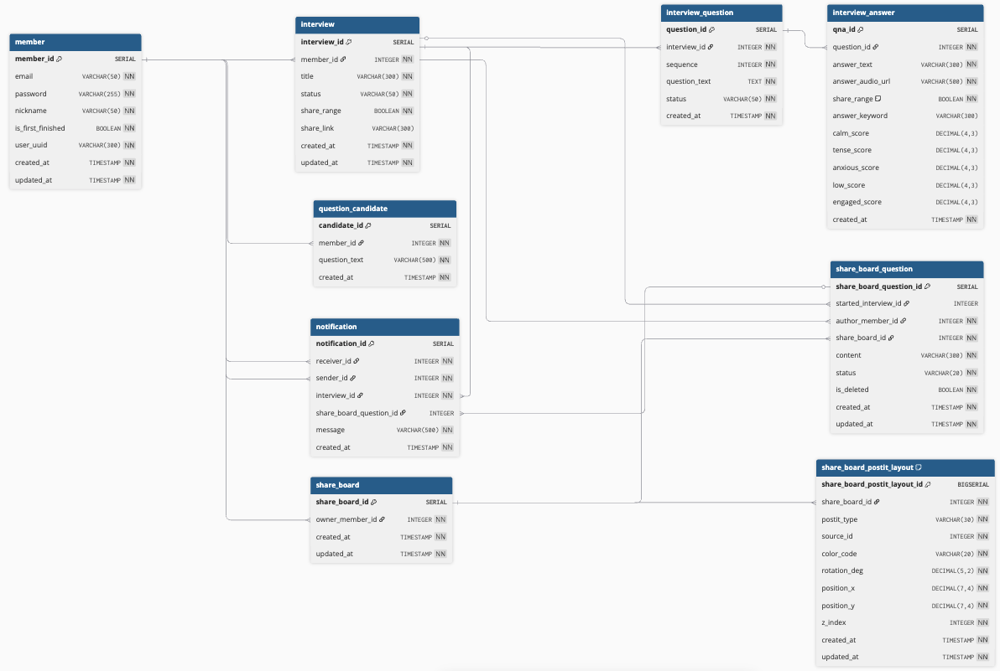

# 💽 The Interview

> 당신의 목소리, 한편의 매거진이 되다.
>

## 📌 프로젝트 개요

### 1. 프로젝트 소개

> **The Interview**는 AI가 맥락에 맞는 질문을 던지고, 사용자는 음성으로 답하며 자신의 생각과 감정을 기록하고 탐색하는 **AI 기반 음성 인터뷰 자기 탐색
플랫폼**입니다.
>

인터뷰는 원래 연예인이나 인플루언서 등 특정 인물에게만 주어지는 경험이었습니다.

**The Interview**는 그 경험을 누구에게나 열어줍니다.

글쓰기가 어려워도 괜찮습니다. 영상이 부담스럽다고 해도 상관없습니다.

AI의 질문에 음성으로 답하기만 하면,

당신의 이야기가 한 편의 매거진이 됩니다

### 2. 기획 배경

현대인은 자신의 생각과 감정을 기록하고 돌아보고자 하는 욕구가 있지만, 이를 실천하기엔 여러 장벽이 존재합니다.

- 📓 **일기** — 무엇을 써야 할지 막막해 지속하기 어려움
- 📱 **SNS** — 타인의 시선을 의식해 솔직한 감정 표현이 어려움
- 🧑‍⚕️ **상담 서비스** — 깊이는 있지만 접근성이 낮고 부담이 큼

**"기록하고 싶다는 욕구와 실제 기록 사이의 간극"**,

The Interview는 이 문제를 **AI 인터뷰 구조**로 해결합니다.

### 3. 주요 기능

🎤 AI 인터뷰

> AI가 주제에 맞는 질문을 생성하고, 사용자의 음성 답변을 자동으로 텍스트로 변환·저장합니다.
>

- AI를 통한 맥락형 질문 생성
- 실시간 음성 → 텍스트 변환
- RAG 기반 개인화 질문 흐름

### 📊 인터뷰 리포트

> 인터뷰 내용을 기반으로 나의 음성 상태와 핵심 키워드를 분석합니다.
>

- 인터뷰 데이터 기반 키워드 추출
- 음성 상태를 분석하여 시각화

### 🎨 인터뷰 모드

> 이전 답변들에 따라 모두 다른, 개인화된 질문으로 시작합니다.
>

- 감정, 가치관, 경험 등 다양한 질문 제공
- 개인별 맞춤형 질문 흐름

### 📰 인터뷰 아카이브

> 나의 인터뷰를 아카이브 형식으로 꺼내볼 수 있습니다.
>

- 인터뷰 음성 재생
- 한 편의 매거진처럼 편집된 결과물

### 🔗 공유

> 인터뷰 결과를 링크로 간편하게 공유할 수 있습니다.
>

- 링크 기반 공유로 생각 나눔 및 공감 형성
- 공유받은 사용자가 남긴 질문으로 인터뷰 시작

---

## 📌 팀원 소개 및 기여 사항

| 팀장                                                                                                                                  | 팀원                                                                     | 팀원        | 팀원                            | 팀원                                                                                                                                                                                                     |
  |-------------------------------------------------------------------------------------------------------------------------------------|------------------------------------------------------------------------|-----------|-------------------------------|--------------------------------------------------------------------------------------------------------------------------------------------------------------------------------------------------------|
| **백우성**                                                                                                                             | **박영운**                                                                | **김현아**   | **김종민**                       | **박성문**                                                                                                                                                                                                |
| @baekus2209                                                                                                                         | @woon0612                                                              | @wynsumhi | @kjmin065999                  | @dev_codelian                                                                                                                                                                                          |
| **AI**                                                                                                                              | **AI / FE**                                                            | **FE**    | **BE**                        | **INFRA / BE**                                                                                                                                                                                         |
| - AI 인터뷰 파이프라인 설계 및 구현<br>- STT 후처리 및 음성/텍스트 기반 인터뷰 상태 분석 로직 구현<br>- RAG 기반 개인화 질문 흐름 설계 및 연동<br>- AI-백엔드 연동 구조 설계 및 FastAPI 서비스 구축 | - 음성 변환 로직 구현<br>- 음성 선택 옵션 기능 구현<br>- 인터뷰 전 과정 프롬프팅<br>- 회원 관련 API 연동 | <추가예정>    | - 인터뷰 플로우 개발<br>- 회원 관련 기능 개발 | - EC2 Docker 기반 인프라 구축 및 Jenkins CI/CD 파이프라인 설계/운영<br>- Prometheus, Grafana, Loki 모니터링 시스템 구축<br>- 인터뷰 공유/탐색/북마크 기능 구현<br>- 인터뷰 이어하기/강제종료/알림 등 비즈니스 로직 구현<br>- Nginx 리버스 프록시, SSL, 환경변수 관리 등 서비스 운영 전반 |

---

## 📌 프로젝트 시스템

### 시스템 아키텍처


### 기술 스택

| **Category**   | **Stack**                                                                    |
|----------------|------------------------------------------------------------------------------|
| **FrontEnd**   | React, Next.js, Typescript, pnpm, Zustand                                    |
| **BackEnd**    | Java, Spring Boot, Spring Security, JPA, JWT, WebSocket(STOMP)               |
| **AI**         | Python, FastAPI, OpenAI Whisper(STT), Claude, Gemini, Qdrant, Supertonic TTS |
| **Database**   | PostgreSQL, Redis                                                            |
| **CI / CD**    | Jenkins, GitLab Webhook                                                      |
| **Docs**       | Swagger                                                                      |
| **Infra**      | AWS EC2, Docker, Docker Compose, Nginx, Let’s Encrypt(SSL)                   |
| **Monitoring** | Grafana, Prometheus, Loki, Promtail, cAdvisor, Node Exporter                 |

### 프로젝트 구조

```
S14P21A307/
├── .gitlab/
│   └── merge_request_templates/     # GitLab MR 템플릿 정의
├── ai/                              # AI 서비스 (FastAPI)
│   └─── app/
│       ├── api/
│       │   └── v1/
│       │       ├── endpoints/       # API 엔드포인트 (interview, stt, health, rag)
│       │       └── schemas/         # 요청/응답 Pydantic 스키마
│       ├── core/                    # 앱 설정, 인증, 공통 유틸
│       ├── models/
│       │   ├── llm/                 # LLM 클라이언트 (Claude, Gemini)
│       │   ├── rag/                 # RAG 관련 (Qdrant 벡터 스토어, 임베딩 클라이언트)
│       │   ├── stt/                 # STT 클라이언트 (OpenAI Whisper)
│       │   └── tts/                 # TTS 클라이언트 (Supertonic GPU, OpenAI 폴백)
│       ├── pipeline/                # 인터뷰 파이프라인 오케스트레이션
│       ├── prompts/                 # LLM 프롬프트 템플릿
│       └── services/                # 비즈니스 로직 (인터뷰, STT, TTS, RAG 서비스)
│
├── be/                              # Backend 서비스 (Spring Boot)
│   ├── theinterview/
│   │   └── src/
│   │       ├── main/
│   │       │   ├── java/com/theinterview/
│   │       │   │   ├── domain/
│   │       │   │   │   ├── example/             # 예제 도메인
│   │       │   │   │   │   ├── controller/
│   │       │   │   │   │   ├── dto/
│   │       │   │   │   │   ├── repository/
│   │       │   │   │   │   └── service/
│   │       │   │   │   ├── interview/           # 인터뷰 도메인 (핵심)
│   │       │   │   │   │   ├── Repository/
│   │       │   │   │   │   ├── controller/
│   │       │   │   │   │   ├── dto/
│   │       │   │   │   │   ├── entity/
│   │       │   │   │   │   ├── enums/
│   │       │   │   │   │   ├── facade/          # 복합 비즈니스 로직 조합
│   │       │   │   │   │   ├── service/
│   │       │   │   │   │   └── test/
│   │       │   │   │   ├── member/              # 회원 도메인
│   │       │   │   │   │   ├── controller/
│   │       │   │   │   │   ├── dto/
│   │       │   │   │   │   ├── repository/
│   │       │   │   │   │   └── service/
│   │       │   │   │   └── shareboard/          # 공유 게시판 도메인
│   │       │   │   │       ├── controller/
│   │       │   │   │       ├── dto/
│   │       │   │   │       ├── entity/
│   │       │   │   │       ├── enums/
│   │       │   │   │       ├── repository/
│   │       │   │   │       └── service/
│   │       │   │   └── global/
│   │       │   │       ├── config/
│   │       │   │       │   └── redis/           # Redis 설정 (캐싱)
│   │       │   │       ├── response/
│   │       │   │       │   ├── exception/
│   │       │   │       │   │   └── handler/     # 전역 예외 핸들러
│   │       │   │       │   └── status/          # 응답 상태 코드 정의
│   │       │   │       ├── security/
│   │       │   │       │   └── config/
│   │       │   │       │       ├── internal/    # 내부 API 토큰 인증 필터 (AI↔BE)
│   │       │   │       │       ├── jwt/         # JWT 발급/검증
│   │       │   │       │       └── websocket/   # WebSocket(STOMP) 설정
│   │       │   │       └── util/                # 공통 유틸리티
│   │       │   └── resources/
│   │       │       └── style/                   # 정적 리소스 (스타일)
│   │       └── test/
│   │           └── java/com/theinterview/       # 단위 테스트
│   └── websocket-test/                          # WebSocket 수동 테스트용 클라이언트
│
├── infra/                           # 인프라 구성
│   ├── app/                         # Application 계층 Compose (BE, FE)
│   ├── database/                    # Database 계층 Compose (PostgreSQL, Redis)
│   ├── management/                  # Management 계층 Compose (Nginx, Jenkins, Bridge)
│   │   └── nginx/                   # Nginx 설정 (리버스 프록시, SSL/TLS)
│   ├── monitoring/                  # Monitoring 계층 Compose (Prometheus, Grafana, Loki, Promtail)
│   ├── network/                     # Docker 커스텀 네트워크 생성 스크립트
│   └── webhook-service/             # GitLab→Mattermost 웹훅 브릿지 서버 (Spring Boot)
│       └── src/
│           └── main/
│               ├── java/com/theinterview/webhook/
│               │   ├── client/      # Mattermost HTTP 클라이언트
│               │   ├── controller/  # GitLab Webhook 수신 컨트롤러
│               │   ├── converter/   # GitLab 이벤트 → Mattermost 마크다운 변환
│               │   ├── dto/
│               │   │   ├── request/             # GitLab Webhook 요청 DTO
│               │   │   └── response/
│               │   │       └── status/          # 응답 상태 코드
│               │   └── service/     # 이벤트 처리 비즈니스 로직
│               └── resources/       # application.yaml 설정
│
├── docs/                            # 프로젝트 문서
├── Jenkinsfilebe                    # BE CI/CD 파이프라인
└── Jenkinsfilefe                    # FE CI/CD 파이프라인
```

### ERD



---

## 📌 개발 환경 설정 가이드 ( 포팅 메뉴얼 )

### 포트 관리

| 구성 요소         | 기술 스택                            | 포트               |
|---------------|----------------------------------|------------------|
| FrontEnd      | Next.js 16, React 19, TypeScript | 3000             |
| Backend       | Spring Boot 4.0.3, Java 17       | 8080             |
| AI            | FastAPI, Python 3.11, CUDA 12.4  | 8000             |
| Database      | PostgreSQL 16 (pgvector)         | 5432             |
| Cache         | Redis (Alpine)                   | 6379             |
| VectorDB      | Qdrant                           | 6333, 6334       |
| Embedding     | vLLM (Qwen3-Embedding-0.6B)      | 8001             |
| Reverse Proxy | Nginx (SSL/TLS)                  | 443              |
| CI / CD       | Jenkins LTS                      | 8989             |
| Monitoring    | Prometheus + Grafana + Loki      | 9090, 3000, 3100 |

---

### 소프트웨어 버전

| 소프트웨어          | 버전                   | 비고                         |
|----------------|----------------------|----------------------------|
| Java           | 17 (Eclipse Temurin) | Backend                    |
| Gradle         | 9.3.1                | Backend 빌드 도구 (Wrapper 포함) |
| Node.js        | 20.x LTS             | Frontend                   |
| pnpm           | latest (corepack)    | Frontend 패키지 매니저           |
| Python         | 3.11                 | AI Server                  |
| Docker         | 최신                   | 컨테이너 런타임                   |
| Docker Compose | v2 이상                | 멀티 컨테이너 관리                 |
| NVIDIA Driver  | CUDA 12.4 호환         | AI Server GPU 가속 (선택)      |

---

### 환경변수

```json
#------------------------------------------------------------
# [DataBase]
# PostgreSQL
DB_HOST=
DB_NAME=
DB_USER=
DB_PASSWORD=

# Redis
REDIS_HOST=
REDIS_PASSWORD=
#------------------------------------------------------------
# [BE/FE/AI]
# GMS
GMS_KEY=<GMS-key>

# JWT
JWTSECRET=

# QDRANT
QDRANT_URL=
QDRANT_COLLECTION_NAME=
QDRANT_VECTOR_SIZE=

# EC2 Audio Path
SERVER_AUDIO_PATH=<audio-file 저장경로>

# FastAPI URL
FASTAPI_SERVER_URL=
FASTAPI_SERVICE_TOKEN: AUTH_TOKEN=
BACKEND_INTERNAL_TOKEN=

# BE
AI_INTERNAL_TOKEN: # AI
APP_ENV=
BACKEND_INTERNAL_BASE_URL_LOCAL=
BACKEND_INTERNAL_BASE_URL_PROD=
BACKEND_INTERNAL_TIMEOUT_SECONDS=
AUTH_ENABLED=
DEFAULT_EMBEDDING_MODEL=

# Share Board Endpoint
SHARE_INTERVIEW_ENDPOINT=<공유 게시판 endpoint>
```

### **FrontEnd 환경변수**

```json
# 빌드 시 필수 (없으면 빌드 실패)
API_URL=<Server-url>

# 클라이언트 사이드
NEXT_PUBLIC_JWT_SECRET=<your-jwt-secret>
```

---

### 로컬 개발 환경 세팅

#### **Backend 로컬 실행**

```json
# 1. PostgreSQL + Redis 로컬 실행
cd be/theinterview
docker compose up -d

# 2. 환경변수 설정
export JWTSECRET=<your-jwt-secret>
export FASTAPI_SERVICE_TOKEN=<your-token>
export AI_INTERNAL_TOKEN=<your-token>
export SHARE_INTERVIEW_ENDPOINT=<endpoint-url>

# 3. 빌드 및 실행
./gradlew bootRun
```

- API 서버:`http://localhost:8080/api`
- Swagger UI:`http://localhost:8080/api/swagger-ui.html`

#### **Frontend 로컬 실행**

```json
# 1. 환경변수 설정 (.env.template 참조)
cp .env.template .env.local
# .env.local 편집: #   API_URL=http: //localhost:8080
#   NEXT_PUBLIC_JWT_SECRET=<your-jwt-secret>

# 2. 의존성 설치 및 실행
corepack enable
pnpm install
pnpm dev
```

• 개발 서버:`http://localhost:3000`

#### **AI Server 로컬 실행**

```json
cd ai

# 1. 환경변수 설정 (.env 파일 생성)
# 필수: OPENAI_API_KEY, ANTHROPIC_API_KEY 등

# 2. Docker Compose로 실행 (FastAPI + Embedding Server + Qdrant)
docker compose up -d
```

- AI API:`http://localhost:8000/api/v1/ai`
- Embedding Server:`http://localhost:8001`
- Qdrant Dashboard:`http://localhost:6333/dashboard`

> **참고:**GPU가 필요합니다(NVIDIA CUDA 12.4). GPU가 없는 경우`docker-compose.yml`에서 GPU 설정을 제거하고
`TTS_PROVIDER=cpu`로 변경하세요.
>

---

### 인프라 구성

#### **Docker 네트워크**

모든 서비스는`theinterview-net`Docker 네트워크를 통해 통신합니다.

```bash
cd infra/network
./setup-network.sh
```

#### **Docker Compose 파일 구성**

| **파일**                 | **경로**              | **서비스**                                                      |
|------------------------|---------------------|--------------------------------------------------------------|
| db-compose.yml         | `infra/database/`   | PostgreSQL (pgvector), Redis                                 |
| app-compose.yml        | `infra/app/`        | Backend, Frontend                                            |
| management-compose.yml | `infra/management/` | Nginx, Jenkins, Bridge Server                                |
| monitoring-compose.yml | `infra/monitoring/` | Prometheus, Grafana, Loki, Promtail, Node Exporter, cAdvisor |
| docker-compose.yml     | `ai/`               | FastAPI, vLLM Embedding Server, Qdrant                       |

#### **Nginx 리버스 프록시 경로**

| **경로**               | **대상 서비스**           | **설명**        |
|----------------------|----------------------|---------------|
| `/`                  | Frontend (3000)      | 메인 웹 페이지      |
| `/api/*`             | Backend (8080)       | REST API      |
| `/api/ws-connect/*`  | Backend (8080)       | WebSocket     |
| `/api/ws-url/*`      | Frontend (3000)      | WebSocket URL |
| `/api/v1/ai/*`       | FastAPI (8000)       | AI API        |
| `/infra/jenkins/*`   | Jenkins (8989)       | CI/CD         |
| `/infra/grafana/`    | Grafana (3000)       | 모니터링 대시보드     |
| `/infra/prometheus/` | Prometheus (9090)    | 메트릭 수집        |
| `/infra/webhook/*`   | Bridge Server (9123) | GitLab 웹훅     |

> Bridge Server는 Gitlab MR 관리용 Webhook 서버로 제외하시는걸 권장합니다.
>

---

### 빌드 및 배포

#### Backend

- 포트: 8080
- 메모리 제한: 2GB
- JVM 옵션:`Xms1024m -Xmx2048m`
- 볼륨:`/home/ubuntu/theInterview/history`→`/app/history`(오디오 파일 저장)

**주요 의존성**

- Spring Boot 4.0.3 (Web MVC, Security, WebSocket, WebFlux, Data JPA)
- PostgreSQL Driver + pgvector
- Redis (Spring Data Redis)
- JWT (jjwt 0.12.5)
- OAuth2 Client
- Swagger (springdoc-openapi 3.0.2)
- Lombok

#### Frontend

- 포트: 300
- 메모리 제한: 512MB

**주요 의존성**

- Next.js 16.1.6, React 19.2.3
- TanStack React Query 5 (데이터 페칭)
- Zustand 5 (상태 관리)
- Axios (HTTP 클라이언트)
- STOMP.js + SockJS (WebSocket)
- Framer Motion (애니메이션)
- Tailwind CSS 4

**API 프록시 설정**

`next.config.ts`에서 API 요청을 백엔드로 프록시합니다:

- `/api/v1/*`→`${API_URL}/api/v1/*`
- `/api/ws-connect/*`→`${API_URL}/api/ws-connect/*`

#### AI

**서비스 구성**

| **서비스**          | **이미지**                     | **포트**     | **GPU** | **메모리** |
|------------------|-----------------------------|------------|---------|---------|
| FastAPI          | theinterview-fastapi        | 8000       | 필요      | 3GB     |
| Embedding Server | vLLM (Qwen3-Embedding-0.6B) | 8001       | 필요      | -       |
| Qdrant           | qdrant/qdrant               | 6333, 6334 | 불필요     | -       |

**GPU 요구 사항**

- NVIDIA GPU (CUDA 12.4 호환)
- GPU 메모리 활용률: 75% (vLLM 설정)
- TTS 모델: Supertonic-2 (CUDA 가속)
- GPU가 없는 경우 TTS_PROVIDER를`cpu`로 변경 가능

**AI 모델 구성**

| **용도**        | **모델**                | **비고**        |
|---------------|-----------------------|---------------|
| STT           | OpenAI Whisper-1      | 한국어 음성 인식     |
| TTS           | Supertonic-2 (F3 음성)  | CUDA 가속, 한국어  |
| LLM (인터뷰)     | Claude Sonnet 4.5     | Anthropic API |
| LLM (제목/키워드)  | Gemini 2.5 Flash Lite | Google API    |
| Embedding     | Qwen3-Embedding-0.6B  | vLLM 자체 호스팅   |
| Vector Search | Qdrant                | 1024차원 벡터     |

---

### 인프라 전체 배포

#### **전체 서비스 일괄 배포**

```json
cd infra
./self-deploy-all.sh
```

실행 순서:

1. Docker 네트워크 생성 (`theinterview-net`)
2. 데이터베이스 레이어 (PostgreSQL, Redis)
3. 관리 레이어 (Nginx, Jenkins, Bridge Server)
4. 모니터링 레이어 (Prometheus, Grafana, Loki, Promtail)
5. 애플리케이션 레이어 (Backend, Frontend)

#### **개별 레이어 배포**

```bash
# 데이터베이스만
cd infra/database && docker compose -f db-compose.yml up -d

# 관리 도구만
cd infra/management && docker compose -f management-compose.yml up -d

# 모니터링만
cd infra/monitoring && docker compose -f monitoring-compose.yml up -d

# 애플리케이션만
cd infra/app && docker compose -f app-compose.yml up -d

# AI 서버 (별도 서버 또는 GPU 서버)
cd ai && docker compose up -d
```

### **8.3 메모리 제한 요약**

| **서비스**       | **메모리 제한** |
|---------------|------------|
| PostgreSQL    | 1GB        |
| Redis         | 256MB      |
| Backend       | 2GB        |
| Frontend      | 512MB      |
| FastAPI       | 3GB        |
| Jenkins       | 3GB        |
| Bridge Server | 384MB      |
| Prometheus    | 1GB        |
| Grafana       | 356MB      |
| cAdvisor      | 300MB      |
| **최소 총합**     | **약 12GB** |

---

### 유의사항

#### **1. PostgreSQL pgvector 확장**

- pgvector 이미지(`pgvector/pgvector:pg16`)를 사용해야 벡터 연산이 가능합니다. 일반 PostgreSQL 이미지로는 동작하지 않습니다.

#### **2. GPU 없이 AI 서버 실행**

- `ai/docker-compose.yml`에서 GPU 관련 설정을 제거하고, 환경 변수`TTS_PROVIDER=cpu`로 변경하면 CPU 모드로 실행 가능합니다. 단, TTS
  성능이 크게 저하됩니다.

#### **3. Frontend 빌드 실패**

- `API_URL`환경 변수가 설정되지 않으면`next.config.ts`에서 빌드가 실패합니다. Docker 빌드 시`--build-arg API_URL=<url>`을 반드시
  전달해야 합니다.