### 유저 시나리오

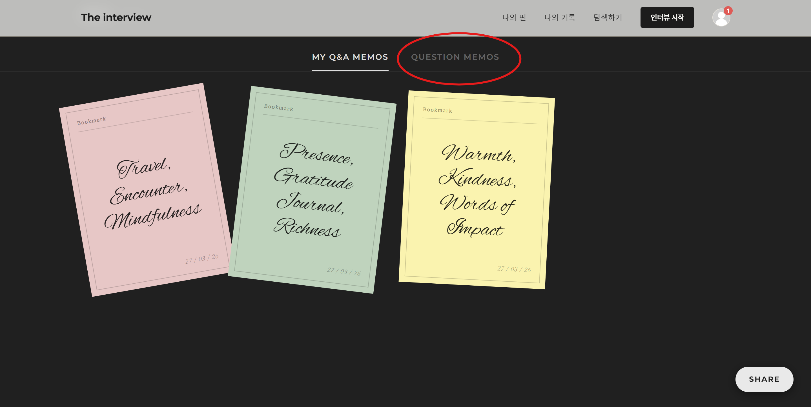

- 먼저 첫 화면에서 `Question Memos`를 클릭합니다.

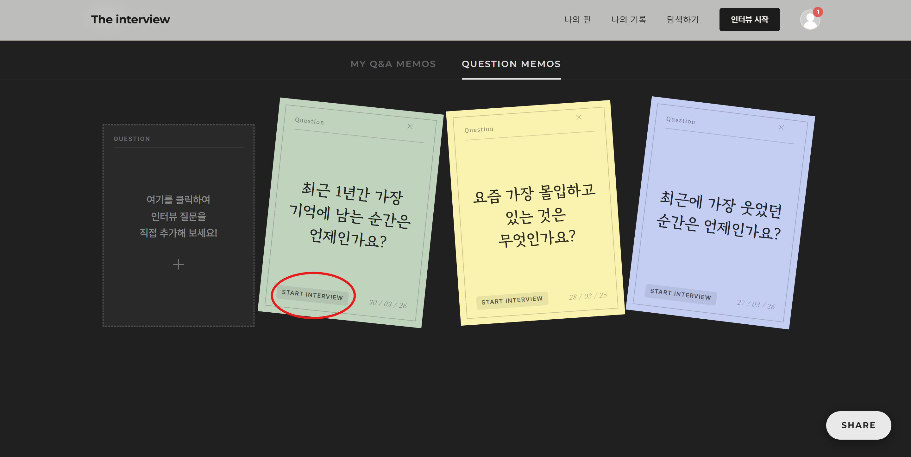

- 해당 화면에선 받은 질문들이 보이고, 하나를 선택하여 인터뷰를 시작합니다.
- 저희는 `최근 1년간 가장 기억에 남는 순간은 언제인가요?`를 시작하도록 하겠습니다.

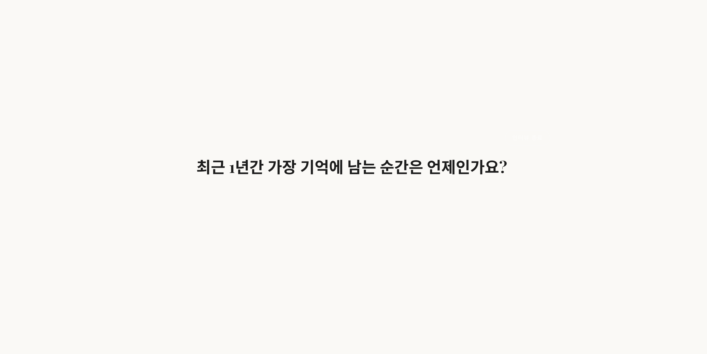

- 해당 질문을 가지고 인터뷰를 시작하며 해당 문구는 TTS를 통해 내용을 읽어줍니다.

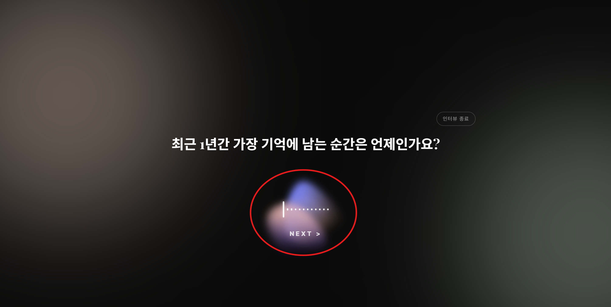

- 사용자는 해당 화면이 활성화되면 질문에 대한 답변을 남깁니다.
- 답변이 끝나면 `Next`를 눌러 해당 답변에 대한 꼬리 질문을 받습니다

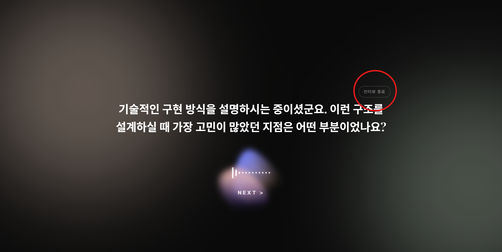

- 꼬리 질문을 받고 답변을 하며, 만약 더 이상 인터뷰를 진행하고 싶지 않다면 `인터뷰 종료`를 클릭하여 인터뷰를 종료합니다.

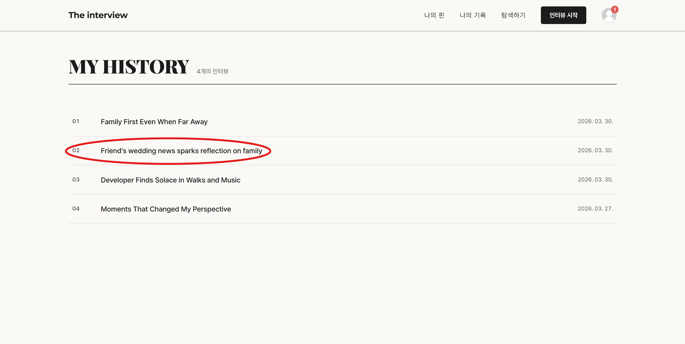

- 인터뷰가 종료되면 자동으로 `나의 기록` 페이지로 넘어가며 여기서는 앞 서 진행하였던 사용자의 모든 인터뷰 기록을 조회할 수 있습니다.

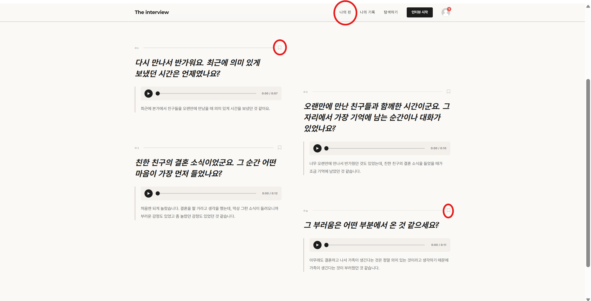

- 하나의 인터뷰를 클릭하여 `인터뷰 상세페이지`로 들어간다면 질문과 답변을 볼 수 있고, 당시 인터뷰 내용도 다시 들을 수 있습니다.
- 또한 북마크를 추가하여 처음 화면에서 `포스트 잇` 형태로 확인할 수 있습니다.
- `나의 핀`을 클릭하여 초기 화면으로 이동합니다.

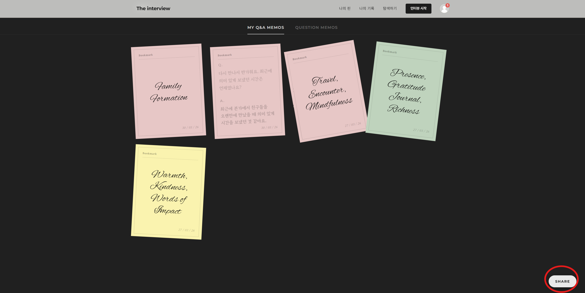

- `나의 핀`에서는 방금 북마크한 내용을 확인할 수 있으며, `SHARE` 버튼을 눌러 해당 보드를 다른 사람에게 공유할 수 있습니다.

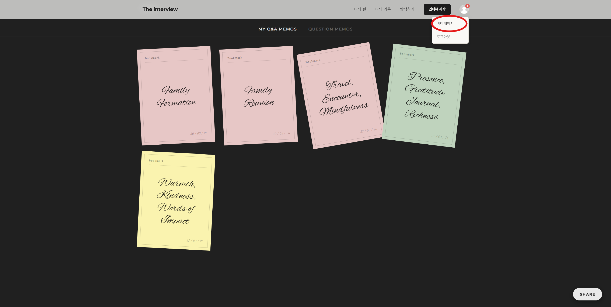

- 사용자 아이콘에서는 내가 다른 사용자에게 남긴 질문을 바탕으로 해당 사용자가 인터뷰를 진행하면 해당 결과를 알려주게 됩니다.

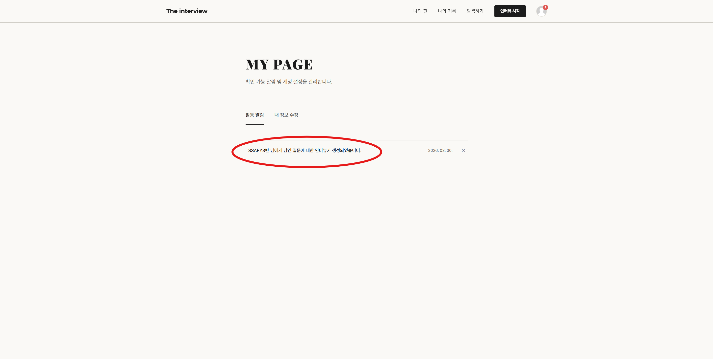

- 내가 남긴 질문에 대하여 해당 사용자가 답변을 남기면 알림이 생기며 해당 알림을 클릭하면 `인터뷰 상세페이지`로 넘어가게 됩니다.

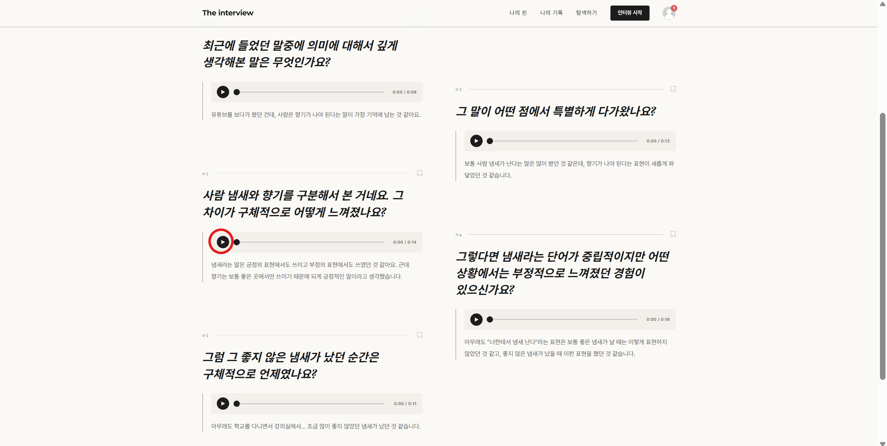

- 해당 페이지에서는 사용자의 인터뷰 전문을 확인할 수 있으며, `재생 버튼`을 눌러 직접 음성을 들을 수 있습니다.

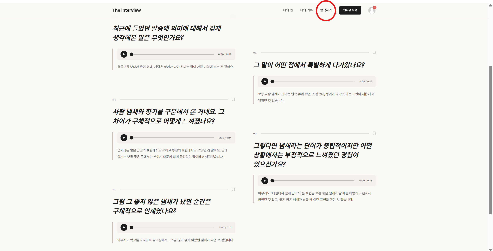

- 다음은 `탐색하기` 입니다.

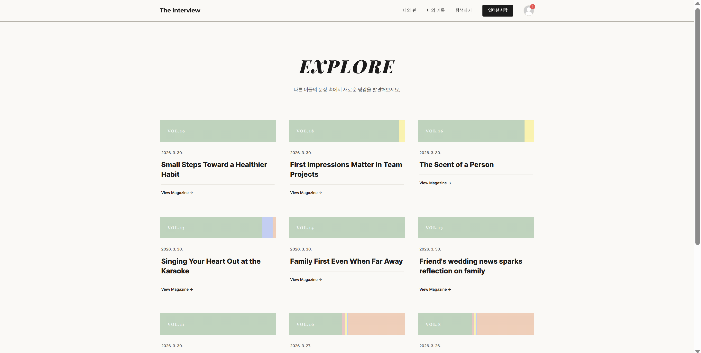

- `탐색하기`는 서비스를 이용하는 모든 이용자들이 공유 범위를 `공개`로 둔 모든 인터뷰를 조회할 수 있습니다.
- 각 인터뷰 타이틀 위에서는 해당 인터뷰를 진행한 사용자의 목소리를 분석하여 당시의 감정 지표를 확인할 수 있습니다.
- 인터뷰를 클릭하면 `인터뷰 상세페이지`로 이동하게 됩니다.